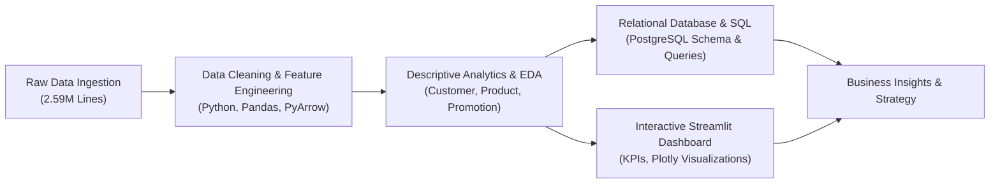

# Retail Customer, Product & Promotion Intelligence

An end-to-end retail data analytics and business intelligence project evaluating two years of household purchasing behavior, category merchandising performance, and direct marketing campaign effectiveness using the **dunnhumby – The Complete Journey** dataset.

Built with **Python, Pandas, NumPy, PostgreSQL, Streamlit, and Plotly**.

---

## 1. Executive Summary & Key Findings

The project analyzes **2,595,732 transaction lines** across **2,500 frequent-shopper households**, **276,484 shopping baskets**, and **92,353 products** over 102 weeks (711 days), delivering **$8,057,463.08** in total recorded sales.



### Key Findings Supported by Data:
1. **Customer Revenue Concentration (Pareto 80/20 Rule)**:
   - The top **20% of households (500 families)** account for **53.1% ($4.27M)** of total company revenue.
   - The top **10% alone** generates **32.8% ($2.64M)**. In contrast, the bottom 40% of households collectively generate less than 13% of sales.
   - **RFM Segmentation**: "Champions / Core Loyal" households (28.6% of population) drive **63.5% of sales ($5.12M)**, visiting twice a week (204 trips) and spending over $7,100 per household.
   - **At Risk High-Value**: 3.4% of households represent substantial past spend ($310K) but have become inactive for 45+ days, identifying an immediate win-back priority.
2. **Product Hierarchy & Catalog Rationalization**:
   - **Department Anchors**: **GROCERY** generates **50.5% of sales ($4.07M)** and appears in **91.8% of all shopping baskets**. **DRUG GM** ($1.22M, 15.2% share) and **PRODUCE** ($603K, 7.5% share, 64.9% basket penetration) serve as primary traffic drivers.
   - **Private Label Dynamics**: Store brands generate **24.5% of total sales ($1.97M)** and 27.8% of items sold, priced 15–25% below National Brands.
   - **The Long-Tail Problem**: Out of 92,353 active SKUs, **51,180 SKUs (55.4%) generated less than $50 total over two years**, and 48% sold fewer than 10 units, revealing extensive inventory holding inefficiencies.
   - **Holiday Seasonality**: Weekly sales follow a consistent baseline (~$75K–$85K/week), but surge **25–35%** in **Weeks 48–52** (Year 1 holiday peak: ~$110K) and **Weeks 99–102** (Year 2 holiday peak: ~$118K).
3. **Promotion & Campaign Dynamics**:
   - **Loyalty Program Dominance**: Retail loyalty card discounts (`RETAIL_DISC`) account for **97.0% of all customer promotional discounts** ($1.45M out of $1.50M total discounts), used on **56.4% of all baskets**.
   - **Direct Marketing Effectiveness**: Across 30 direct mail campaigns, personalized **Type A campaigns** achieved more than double the household participation rate of generic broadcast mailers (**10.6% vs 4.9%**), generating **74.2% of all coupon redemptions**.
   - **Coupon Redeemer Profile**: The 434 coupon-redeeming households spend an average of **$5,785** (+115% vs non-redeemers: $2,684), driven by **double the trip frequency (194 trips vs 93 trips)**, not larger individual basket values ($30.95 vs $28.47).

---

## 2. Project Structure

```text
retail-customer-product-and-promotion-intelligence/
├── app.py                                 # Interactive Streamlit executive dashboard
├── data/
│   ├── raw/                               # Unmodified raw dunnhumby source CSVs
│   │   ├── campaign_desc.csv
│   │   ├── campaign_table.csv
│   │   ├── coupon.csv
│   │   ├── coupon_redempt.csv
│   │   ├── hh_demographic.csv
│   │   ├── product.csv
│   │   ├── transaction_data.csv
│   │   └── User_Guide.pdf
│   └── processed/                         # Cleaned, standardized & aggregated data
│       ├── baskets.csv                    # 276,484 shopping trips (basket grain)
│       ├── cleaned_campaign_households.csv
│       ├── cleaned_campaigns.csv
│       ├── cleaned_coupon_redemptions.csv
│       ├── cleaned_coupons.csv            # 119,384 deduplicated mappings
│       ├── cleaned_demographics.csv
│       ├── cleaned_products.csv
│       ├── cleaned_transactions.csv       # Preserved 2,595,732 transaction lines
│       ├── cleaned_transactions.parquet   # High-performance Parquet format
│       └── household_summary.csv          # 2,500 household RFM & KPI summary
├── notebooks/                             # Executed Jupyter analysis notebooks
│   ├── 01_data_understanding.ipynb        # Data audit, foreign keys, table grains
│   ├── 02_data_cleaning.ipynb             # Type casting, discount derivation, export
│   ├── 03_customer_analysis.ipynb         # Spend distributions, Pareto, RFM, demographics
│   ├── 04_product_sales_analysis.ipynb    # Department share, private label, long tail, trends
│   └── 05_promotion_analysis.ipynb        # In-store discounts, campaign ROI, coupon curves
├── sql/                                   # PostgreSQL relational database scripts
│   ├── schema.sql                         # PostgreSQL DDL tables, indexes, and COPY instructions
│   ├── customer_analysis.sql              # Pareto CTEs, RFM NTILEs, visit cadence LAGs
│   ├── product_sales_analysis.sql         # Department rankings, brand splits, moving averages
│   └── promotion_analysis.sql             # Discount composition, redemption rates, curves
├── reports/                               # Strategic leadership reports
│   └── executive_summary_and_business_recommendations.md
├── docs/                                  # Technical & analytical documentation
│   ├── 01_Project_Overview.md
│   ├── data_dictionary.md                 # Complete schema dictionary
│   ├── methodology_and_assumptions.md     # Formulas, business logic, assumptions
│   └── limitations.md                     # Constraints & bias documentation
├── src/                                   # Reusable Python modules
│   ├── analytics/
│   │   └── metrics.py                     # RFM calculations, Pareto, dept metrics
│   ├── data_cleaning/
│   │   └── cleaners.py                    # Cleaning pipelines, basket aggregators
│   └── utilities/
│       └── helpers.py                     # Path helpers, formatting utilities
├── requirements.txt                       # Verified project dependencies
└── README.md                              # Main portfolio documentation
```

---

## 3. Environment Setup & How to Run

### 3.1 Setup
Ensure Python 3.10+ is installed:

```bash
# Clone the repository
git clone <repo-url>
cd retail-customer-product-and-promotion-intelligence

# Create and activate virtual environment
python3 -m venv .venv
source .venv/bin/activate  # On Windows: .venv\Scripts\activate

# Install required packages
pip install -r requirements.txt
```

### 3.2 Launch the Interactive Streamlit Dashboard
To launch the interactive dashboard locally:

```bash
streamlit run app.py
```

The dashboard includes 5 comprehensive analytical views:
1. **Executive Overview**: Financial KPIs, weekly revenue trend with 4-week MA, Pareto Lorenz curve.
2. **Customer & RFM Intelligence**: Customer value distributions, RFM segmentation matrix, demographic spend breakdowns.
3. **Product & Assortment**: Department revenue & penetration, Private Label share, SKU velocity tiers and long-tail analysis.
4. **Promotion & Campaign ROI**: Campaign portfolio performance, Type A vs Type B/C comparison, redeemer vs non-redeemer profiles.
5. **SQL Query Explorer**: Live repository of production-grade PostgreSQL analytical queries.

### 3.3 Executing the Notebooks
To re-run any notebook:

```bash
jupyter nbconvert --to notebook --execute notebooks/01_data_understanding.ipynb --output 01_data_understanding.ipynb --output-dir notebooks
jupyter nbconvert --to notebook --execute notebooks/02_data_cleaning.ipynb --output 02_data_cleaning.ipynb --output-dir notebooks
jupyter nbconvert --to notebook --execute notebooks/03_customer_analysis.ipynb --output 03_customer_analysis.ipynb --output-dir notebooks
jupyter nbconvert --to notebook --execute notebooks/04_product_sales_analysis.ipynb --output 04_product_sales_analysis.ipynb --output-dir notebooks
jupyter nbconvert --to notebook --execute notebooks/05_promotion_analysis.ipynb --output 05_promotion_analysis.ipynb --output-dir notebooks
```

---

## 4. PostgreSQL Relational Database Implementation

The relational schema implements standard primary and foreign key constraints, composite keys, and indexing across high-cardinality attributes (`household_key`, `product_id`, `basket_id`, `day`, `week_no`).

### Ingestion Steps into PostgreSQL:
1. Connect to PostgreSQL using `psql` or pgAdmin:
   ```bash
   psql -U postgres -d retail_intelligence -f sql/schema.sql
   ```
2. Execute data loading via `\copy`:
   ```sql
   \copy demographics FROM 'data/processed/cleaned_demographics.csv' WITH (FORMAT csv, HEADER true);
   \copy products FROM 'data/processed/cleaned_products.csv' WITH (FORMAT csv, HEADER true);
   \copy campaigns FROM 'data/processed/cleaned_campaigns.csv' WITH (FORMAT csv, HEADER true);
   \copy campaign_households FROM 'data/processed/cleaned_campaign_households.csv' WITH (FORMAT csv, HEADER true);
   \copy coupons FROM 'data/processed/cleaned_coupons.csv' WITH (FORMAT csv, HEADER true);
   \copy coupon_redemptions FROM 'data/processed/cleaned_coupon_redemptions.csv' WITH (FORMAT csv, HEADER true);
   \copy baskets FROM 'data/processed/baskets.csv' WITH (FORMAT csv, HEADER true);
   \copy transactions FROM 'data/processed/cleaned_transactions.csv' WITH (FORMAT csv, HEADER true);
   ```
3. Run analytical queries:
   - `sql/customer_analysis.sql`: Pareto decile analysis, RFM segmentation CTE with `NTILE(4)`, inter-visit cadence with `LAG() OVER()`.
   - `sql/product_sales_analysis.sql`: Department rankings, Private Label penetration, top hero SKUs, 4-week rolling moving average.
   - `sql/promotion_analysis.sql`: Promotional discount composition, campaign participation rate, redeemer vs non-redeemer comparison.

---

## 5. Interview Discussion Points & Data Nuances

1. **Transaction Grain vs. Basket Grain**:
   - Transaction data is at product-line grain (receipt line item), not shopping trip grain. Aggregating to basket grain (`BASKET_ID`) is essential to calculate true Average Order Value (AOV), basket item count, and trip frequency.
2. **Negative Discount Encoding**:
   - In dunnhumby data, discounts (`RETAIL_DISC`, `COUPON_DISC`, `COUPON_MATCH_DISC`) are recorded as negative numbers. They must be transformed to positive values for reporting and margin calculations.
3. **Retailer Sales vs. Customer Spend**:
   - `SALES_VALUE` is the amount collected by the retailer (reimbursed by coupon manufacturers later). The customer's out-of-pocket spend is `SALES_VALUE + COUPON_DISC`.
4. **Gasoline Volume Outliers**:
   - Gas station pump transactions have massive recorded quantities (e.g. 89,000) because fuel volume is recorded in pump units or cents. Cross-department quantity comparisons must account for gasoline.
5. **Correlation vs. Causation in Promotions**:
   - Coupon-redeeming households spend 115% more, but this is primarily driven by selection bias: frequent shoppers visit the store twice a week, naturally receiving and clipping more coupons.
6. **Assortment Rationalization**:
   - Over 55% of SKUs generate less than $50 in two years. Pruning the bottom 15–20% of non-performing center-store SKUs directly reduces working capital and inventory holding costs.
