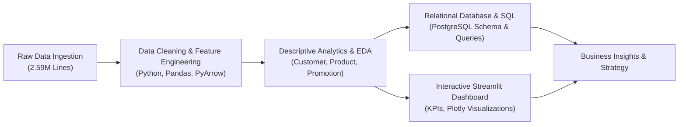

# Retail Customer, Product & Promotion Intelligence

An end-to-end retail data analytics and business intelligence project evaluating two years of household purchasing behavior, category merchandising performance, and direct marketing campaign effectiveness using the **dunnhumby – The Complete Journey** dataset.

Built with **Python, Pandas, NumPy, PostgreSQL, Streamlit, and Plotly**.

---

## 1. Executive Summary & Key Findings

The project analyzes **2,595,732 transaction lines** across **2,500 frequent-shopper households**, **276,484 shopping baskets**, and **92,353 products** over 102 weeks (711 days), delivering **$8,057,463.08** in total recorded sales.



### Key Findings Supported by Data:
1. **Customer Revenue Concentration (Pareto 80/20 Rule)**:
   - The top **20% of households (500 families)** account for **53.1% ($4.27M)** of total company revenue.
   - The top **10% alone** generates **32.8% ($2.64M)**. In contrast, the bottom 40% of households collectively generate less than 13% of sales.
   - **RFM Segmentation**: "Champions / Core Loyal" households (28.6% of population) drive **63.5% of sales ($5.12M)**, visiting twice a week (204 trips) and spending over $7,100 per household.
   - **At Risk High-Value**: 3.4% of households represent substantial past spend ($310K) but have become inactive for 45+ days, identifying an immediate win-back priority.
2. **Product Hierarchy & Catalog Rationalization**:
   - **Department Anchors**: **GROCERY** generates **50.5% of sales ($4.07M)** and appears in **91.8% of all shopping baskets**. **DRUG GM** ($1.22M, 15.2% share) and **PRODUCE** ($603K, 7.5% share, 64.9% basket penetration) serve as primary traffic drivers.
   - **Private Label Dynamics**: Store brands generate **24.5% of total sales ($1.97M)** and 27.8% of items sold, priced 15–25% below National Brands.
   - **The Long-Tail Problem**: Out of 92,353 active SKUs, **51,180 SKUs (55.4%) generated less than $50 total over two years**, and 48% sold fewer than 10 units, revealing extensive inventory holding inefficiencies.
   - **Holiday Seasonality**: Weekly sales follow a consistent baseline (~$75K–$85K/week), but surge **25–35%** in **Weeks 48–52** (Year 1 holiday peak: ~$110K) and **Weeks 99–102** (Year 2 holiday peak: ~$118K).
3. **Promotion & Campaign Dynamics**:
   - **Loyalty Program Dominance**: Retail loyalty card discounts (`RETAIL_DISC`) account for **97.0% of all customer promotional discounts** ($1.45M out of $1.50M total discounts), used on **56.4% of all baskets**.
   - **Direct Marketing Effectiveness**: Across 30 direct mail campaigns, personalized **Type A campaigns** achieved more than double the household participation rate of generic broadcast mailers (**10.6% vs 4.9%**), generating **74.2% of all coupon redemptions**.
   - **Coupon Redeemer Profile**: The 434 coupon-redeeming households spend an average of **$5,785** (+115% vs non-redeemers: $2,684), driven by **double the trip frequency (194 trips vs 93 trips)**, not larger individual basket values ($30.95 vs $28.47).

---

## 2. Project Structure

```text
retail-customer-product-and-promotion-intelligence/
├── app.py                                 # Interactive Streamlit dashboard
├── data/
│   ├── raw/                               # Raw dunnhumby CSV datasets & guide
│   └── processed/                         # Cleaned transaction, basket & summary tables
├── notebooks/                             # Jupyter analysis notebooks
│   ├── 01_data_understanding.ipynb        # Audit, foreign keys, table grains
│   ├── 02_data_cleaning.ipynb             # Cleaning, discount metrics, aggregations
│   ├── 03_customer_analysis.ipynb         # Pareto, RFM segmentation, demographics
│   ├── 04_product_sales_analysis.ipynb    # Department share, private label, long tail
│   └── 05_promotion_analysis.ipynb        # Campaign performance & coupon redemptions
├── sql/                                   # PostgreSQL relational analytical queries
│   ├── schema.sql                         # Table DDL, keys, and indexes
│   ├── customer_analysis.sql              # Pareto CTEs, RFM NTILEs, visit cadence
│   ├── product_sales_analysis.sql         # Department rankings, brand splits, moving avg
│   └── promotion_analysis.sql             # Discount composition, redemption rates
├── reports/                               # Executive summary & recommendations
│   └── executive_summary_and_business_recommendations.md
├── docs/                                  # Project documentation
│   ├── project_overview.md                # Project context & objectives
│   ├── data_dictionary.md                 # Complete schema dictionary
│   ├── methodology_and_assumptions.md     # Formulas, segmentation rules, logic
│   └── limitations.md                     # Dataset constraints & analytical boundaries
├── src/                                   # Reusable Python modules
│   ├── analytics/                         # RFM calculations & Pareto metrics
│   ├── data_cleaning/                     # Pipeline cleaners & basket aggregators
│   └── utilities/                         # Helper functions & formatting
├── requirements.txt                       # Project dependencies
└── README.md
```

---

## 3. Core Analytical Domains & Questions Answered

### 3.1 Customer Intelligence
- **Spend Concentration**: How concentrated is retail revenue among frequent shoppers?  
  *Finding*: Top 20% of households generate 53.1% of company revenue ($4.27M).
- **Behavioral Segmentation**: How can households be segmented without black-box models?  
  *Finding*: Using an explainable RFM quartile framework (`NTILE(4)`), households are partitioned into 6 tiers: Champions (63.5% of sales), Potential Loyalists, At Risk High-Value, Lapsing, Occasional, and Hibernating.
- **Demographic Influences**: How do income and family structure affect basket dynamics?  
  *Finding*: Higher income tiers ($4,500–$5,500+ spend) and families with 3+ members exhibit substantially higher spend per basket ($35–$45 vs $25) rather than higher trip frequency.

### 3.2 Product & Assortment Intelligence
- **Category Roles**: Which departments drive volume versus perimeter traffic?  
  *Finding*: Grocery serves as the primary revenue engine (50.5% share, 91.8% basket penetration), while Produce (64.9% penetration) and Meat drive weekly fresh trip frequency.
- **Store-Brand Value**: What role does Private Label play in customer baskets?  
  *Finding*: Private Label accounts for 24.5% of sales ($1.97M) and 27.8% of items sold, priced 15–25% below National Brands.
- **Assortment Rationalization**: How much of the catalog contributes meaningfully to sales?  
  *Finding*: 55.4% of active SKUs (51,180 items) generate under $50 across two full years, indicating significant inventory holding inefficiencies.

### 3.3 Promotion & Campaign Intelligence
- **Promotional Mix**: Where do customer discount dollars actually go?  
  *Finding*: Automatic loyalty card discounts account for 97.0% of all discounts ($1.45M), utilized on 56.4% of shopping baskets.
- **Campaign Strategy Comparison**: Does personalized coupon targeting outperform broadcast mailers?  
  *Finding*: Type A campaigns (personalized coupon pools) achieve double the household participation rate of broad broadcast mailers (10.6% vs 4.9%), driving 74.2% of all redemptions.
- **Redeemer Behavior**: Do coupons increase transaction size or visit frequency?  
  *Finding*: Coupon redeemers spend 115% more ($5,785 vs $2,684) primarily by shopping twice as often (194 trips vs 93 trips), with comparable basket sizes ($30.95 vs $28.47).

---

## 4. Strategic Business Recommendations

| Strategic Area | Core Finding | Recommended Action | Expected Business Impact |
|---|---|---|---|
| **VIP Retention** | Top 20% drive 53.1% of revenue; 3.4% at risk of churning | Implement automated 30-day inactivity alert and high-impact bounce-back incentives | 15–20% reduction in VIP customer churn; protects ~$70K–$120K annual sales |
| **Assortment Pruning** | 55.4% of SKUs generate < $50 in 2 years | Delist bottom 15–20% low-velocity center-store SKUs; expand facings for top fresh staples | 8–12% reduction in holding costs; reduced out-of-stocks on high-velocity items |
| **Promotional Shift** | Personalized Type A campaigns achieve 2x participation over broadcast | Reallocate print circular budgets into personalized mobile app digital offers | 35–40% increase in promotional marketing ROI by eliminating unread mailers |
| **Private Label Expansion** | Private Label holds 24.5% share, delivering 15–25% consumer savings | Expand store-brand tiers in high-commodity categories (dairy, bakery, paper goods) | 100–150 bps improvement in gross margin across expanded categories |

---

## 5. Interview Discussion Points & Data Nuances

1. **Transaction Grain vs. Basket Grain**:
   - Transaction data is at product-line grain (receipt line item), not shopping trip grain. Aggregating to basket grain (`BASKET_ID`) is essential to calculate true Average Order Value (AOV), basket item count, and trip frequency.
2. **Negative Discount Encoding**:
   - In dunnhumby data, discounts (`RETAIL_DISC`, `COUPON_DISC`, `COUPON_MATCH_DISC`) are recorded as negative numbers. They must be transformed to positive values for reporting and margin calculations.
3. **Retailer Sales vs. Customer Spend**:
   - `SALES_VALUE` is the amount collected by the retailer (reimbursed by coupon manufacturers later). The customer's out-of-pocket spend is `SALES_VALUE + COUPON_DISC`.
4. **Gasoline Volume Outliers**:
   - Gas station pump transactions have massive recorded quantities (e.g. 89,000) because fuel volume is recorded in pump units or cents. Cross-department quantity comparisons must account for gasoline.
5. **Correlation vs. Causation in Promotions**:
   - Coupon-redeeming households spend 115% more, but this is primarily driven by selection bias: frequent shoppers visit the store twice a week, naturally receiving and clipping more coupons.
6. **Assortment Rationalization**:
   - Over 55% of SKUs generate less than $50 in two years. Pruning the bottom 15–20% of non-performing center-store SKUs directly reduces working capital and inventory holding costs.
