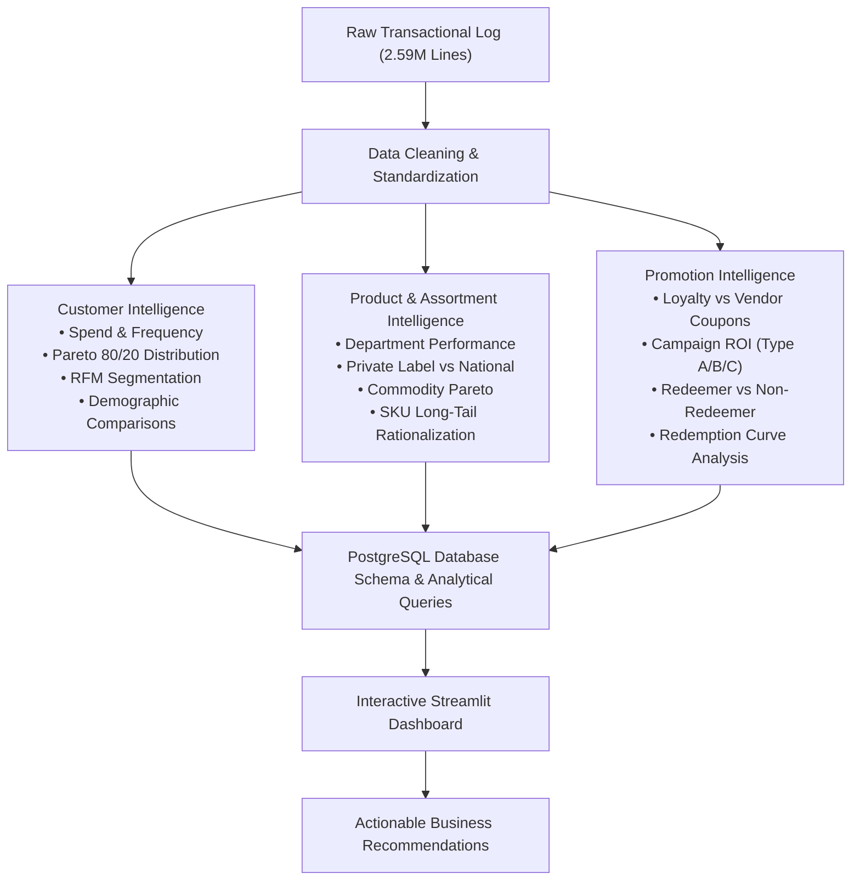

# Retail Customer, Product & Promotion Intelligence

## 1. Project Background & Context
The retail industry operates on tight operating margins (typically 1.5% to 3.5%), making data-driven customer retention, category merchandising, and promotional efficiency central to profitability. This project develops an end-to-end data analytics system leveraging the **dunnhumby – The Complete Journey** dataset, tracking two years of complete household grocery purchasing history across 2,500 frequent-shopper households at a major US retail chain.

The primary objective is to demonstrate senior-level data analysis, data modeling, SQL querying, and interactive dashboard capabilities that translate raw transactional log records into strategic, evidence-backed retail decisions.

---

## 2. Core Pillars of Analysis

### Pillar A: Customer Intelligence
- **Spend & Frequency Distribution**: Quantifying household basket size, shopping cadence, and lifetime value over 102 weeks.
- **Pareto Concentration**: Establishing that the top 20% of households generate 53.1% of company revenue ($4.27M).
- **Descriptive RFM Segmentation**: Classifying customers into 6 explainable tiers (Champions, Active Potential Loyalists, At Risk High-Value, Lapsing, Occasional, Hibernating) using transparent quartile thresholds rather than opaque machine learning clustering.
- **Demographic Profiling**: Profiling income tiers, homeownership status, and household size for the 801 profiled households.

### Pillar B: Product & Sales Intelligence
- **Department Dynamics**: Establishing Grocery as the primary revenue anchor (50.5% share, 91.8% basket penetration), with Produce (64.9% penetration) and Meat as vital fresh perimeter traffic drivers.
- **Brand Architecture**: Assessing Private Label performance (24.5% sales share) and identifying categories with high expansion potential.
- **Category Pareto**: Demonstrating that just 20 commodity categories (out of 308) generate over 50% of store sales.
- **Catalog Rationalization**: Auditing 92,353 active SKUs to identify that over 55% generate less than $50 over 2 years, highlighting immense assortment bloat.
- **Temporal Dynamics**: Tracking weekly revenue trends and 4-week moving averages, uncovering predictable 25–35% sales surges during holiday periods (Weeks 48–52 and 99–102).

### Pillar C: Promotion & Campaign Intelligence
- **Promotional Mix**: Revealing that automatic in-store loyalty card discounts represent 97.0% of all discount dollars ($1.45M), utilized on 56.4% of shopping baskets.
- **Direct Mail Campaign Effectiveness**: Evaluating 30 marketing campaigns across Type A (personalized coupon pools), Type B (broadcast category mailers), and Type C (tactical).
- **Redemption Dynamics**: Documenting that personalized Type A campaigns achieve double the household participation rate (~10.6%) compared to broad broadcast mailers (~4.9%).
- **Customer Engagement Premium**: Demonstrating that coupon-redeeming households spend 115% more ($5,785 vs $2,684) and shop twice as frequently (194 trips vs 93 trips) compared to non-redeemers.

---

## 3. Technology Stack & Artifacts

| Layer | Tools & Technologies | Deliverables |
|---|---|---|
| **Data Ingestion & Cleaning** | Python 3.12, Pandas, NumPy, PyArrow | `01_data_understanding.ipynb`, `02_data_cleaning.ipynb`, `src/data_cleaning/cleaners.py` |
| **Exploratory Data Analysis** | Matplotlib, Seaborn | `03_customer_analysis.ipynb`, `04_product_sales_analysis.ipynb`, `05_promotion_analysis.ipynb` |
| **Relational Database & SQL** | PostgreSQL | `sql/schema.sql`, `sql/customer_analysis.sql`, `sql/product_sales_analysis.sql`, `sql/promotion_analysis.sql` |
| **Interactive Dashboard** | Streamlit, Plotly | `app.py` |
| **Executive Reporting** | Markdown, Mermaid | `reports/executive_summary_and_business_recommendations.md`, `docs/*.md` |
