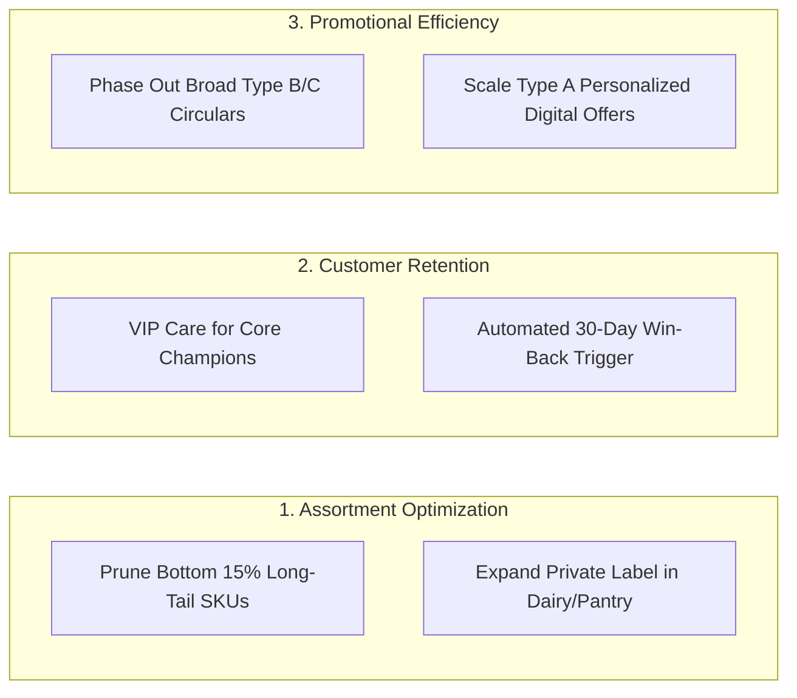

# Executive Summary & Evidence-Based Business Recommendations

**Project**: Retail Customer, Product & Promotion Intelligence  
**Dataset**: dunnhumby – The Complete Journey  
**Prepared For**: Retail Leadership, Category Management & Marketing Strategy  

---

## 1. Executive Summary

This analytics engagement evaluated two full years (102 weeks, 711 days) of point-of-sale transactional history across **2,500 frequent-shopper households** at a major US grocery retailer. Encompassing **2,595,732 product line items**, **276,484 distinct shopping trips**, and **$8,057,463.08 in total recorded sales**, the analysis aimed to uncover structural drivers of revenue, customer retention, product velocity, and promotional return on investment.

### Core Headline Metrics

| Strategic Metric | Value | Retail Benchmark / Context |
|---|---|---|
| **Total Recorded Retail Revenue** | **$8,057,463.08** | Across 2,500 households over 102 weeks |
| **Total Customer Net Spend** | **$8,015,640.83** | After deducting $41.8K in manufacturer coupons |
| **Total Promotional Discounts Delivered** | **$1,496,252.12** | 18.6% overall promotional discount rate |
| **Total Shopping Occasions (Baskets)** | **276,484** | Average of 110.6 trips per household (~1.1 visits/week) |
| **Average Basket Value (AOV)** | **$29.14** | Median: $20.25; Std Dev: $30.82 |
| **Top 20% Customer Contribution** | **53.1% of Revenue** | Top 500 households generate $4.27M in sales |
| **Private Label Sales Share** | **24.5%** | $1.97M across store-brand products |
| **SKUs Generating < $50 over 2 Years** | **55.4% (51,180 SKUs)** | Severe assortment bloat in center store |
| **Loyalty Program Share of Discounts** | **97.0% ($1.45M)** | Frictionless checkout loyalty card savings |
| **Redeemer Spend Premium** | **+115% Spend ($5,785 vs $2,684)** | Driven primarily by 2x trip frequency (194 vs 93 trips) |

---

## 2. Key Analytical Findings

### 2.1 Customer Behavior & Value Concentration
1. **Severe Revenue Skew (The 80/20 Pareto Reality)**:
   - The top **20% of households** (500 families) account for **53.1% ($4.27M)** of total sales.
   - The top **10% of households** (250 families) generate **32.8% ($2.64M)** of sales.
   - Conversely, the bottom 40% of households collectively contribute less than 13% of total revenue.
2. **RFM Customer Segmentation Insights**:
   - **Champions / Core Loyal** (28.6% of households) generate **63.5% of store sales ($5.12M)**, visiting 204 times and spending over $7,100 per household.
   - **At Risk High-Value** (3.4% of households) represent $310K in historical revenue, but have not made a purchase in 45+ days. Lapsing high-value households represent the single largest immediate threat to store revenue.
   - **Active / Potential Loyalists** (20.2% of households) visit regularly (105 trips) with moderate basket sizes ($24.80), representing the highest-potential cohort for basket-building cross-merchandising.
3. **Demographic Dynamics (Profiled Subpopulation)**:
   - **Income Tiers (`classification_3`)**: Higher income brackets (Levels 6–10) spend $4,500–$5,500+ over 2 years, primarily driven by higher average basket sizes ($35–$45) rather than higher trip frequency.
   - **Homeownership**: Confirmed Homeowners exhibit a $3,600 median spend versus $2,100 for Renters, driven by larger pantry restocking trips.
   - **Household Size**: Average spend per basket increases steadily from $25 in single-member households to $42 in households with 4+ members.

---

### 2.2 Product Assortment & Sales Performance
1. **Department Sales Anchors**:
   - **GROCERY** generates **50.5% of revenue ($4.07M)** and penetrates **91.8% of all shopping baskets**.
   - **DRUG GM** ($1.22M, 15.2% share, 57.0% penetration) and **PRODUCE** ($603K, 7.5% share, 64.9% penetration) are essential secondary traffic drivers.
   - **Fresh Perimeter (Produce + Meat + Deli + Bakery)** appears in over 75% of trips, serving as the primary differentiator versus non-traditional grocery discounters.
2. **Brand Architecture (National vs. Private Label)**:
   - Private Label achieves **24.5% revenue share ($1.97M)** and **27.8% of scanned items**.
   - Private Label adoption is strongest in **GROCERY (28.4%)** and **MEAT-PCKGD (29.8%)**, but under-penetrated in **DRUG GM (14.2%)** where National Brand recognition dominates.
   - Private Label items are priced 15–25% below National Brands on average, providing vital price insulation for budget-conscious families.
3. **Category Concentration & Assortment Bloat**:
   - Out of 308 commodity groups, the **top 20 categories generate over 50% of total sales**, led by Soft Drinks ($451K), Fluid Milk ($355K), Bread/Buns ($269K), and Cheese ($254K).
   - **Severe Long-Tail Inefficiency**: Out of 92,353 active SKUs, **51,180 SKUs (55.4%) generated less than $50 total across two years**, and 48% sold fewer than 10 units. This represents trapped working capital, shelf crowding, and elevated holding costs.
4. **Seasonality & Holiday Demand Peaks**:
   - Weekly sales maintain a steady baseline (~$70K–$85K/week), but surge **25–35%** during holiday shopping periods in **Weeks 48–52** (Year 1 holiday peak: ~$110K) and **Weeks 99–102** (Year 2 holiday peak: ~$118K).

---

### 2.3 Promotion Effectiveness & Campaign Dynamics
1. **Promotional Landscape**:
   - **97.0% of all customer promotional discounts** ($1.45M out of $1.50M) are delivered through the **retail loyalty card program** (`RETAIL_DISC`), utilized on **56.4% of all baskets**.
   - Manufacturer coupons (`COUPON_DISC`) account for **2.8% of discount dollars ($41.8K)**, utilized on 3.3% of baskets.
2. **Direct Marketing Campaign Architecture (30 Campaigns)**:
   - **Type A (Personalized Coupon Pools)**: Generated **1,720 redemptions (74.2% of all campaign redemptions)** with an average household participation rate of **10.6%**.
   - **Type B (Broadcast Thematic Mailers)**: Averaged a lower participation rate of **4.9%**.
   - **Type C (Tactical Mailers)**: Averaged **4.1%** participation.
3. **The Coupon Redeemer Profile**:
   - The 434 coupon-redeeming households spend an average of **$5,785** over 2 years compared to **$2,684** for non-redeemers (+115% premium).
   - **Key Finding**: Redeemers do not have substantially larger single baskets ($30.95 vs $28.47); rather, they shop **twice as frequently (193.8 trips vs 93.1 trips)**. They are highly engaged store loyalists who clip coupons on regular pantry restocking routines.

---

## 3. Evidence-Based Strategic Recommendations

### Recommendation 1: High-Value Customer Retention & Win-Back Protocols
- **Business Rationale**: With 28.6% of households driving 63.5% of revenue, the loss of even 50 Core Champions represents ~$350,000 in lost annual sales.
- **Action Plan**:
  1. **Automated At-Risk Trigger**: Establish an automated alert when a high-value customer's visit cadence exceeds 2.5x their personal inter-visit interval (typically 21–30 days of inactivity).
  2. **High-Impact Win-Back Offer**: Deliver an aggressive bounce-back incentive (e.g., "$15 off a $75 purchase") before the customer forms shopping habits with a competitor.
  3. **Champion VIP Perks**: Introduce surprise-and-delight rewards (e.g. double fuel points, free premium sample items) to protect the core loyalty of top-decile shoppers.

### Recommendation 2: Assortment Rationalization (SKU Optimization)
- **Business Rationale**: 55.4% of catalog SKUs generate under $50 in 2 years, tying up working capital and cluttering center-store aisles.
- **Action Plan**:
  1. **Delist Bottom 15% Non-Performing SKUs**: Conduct category reviews in Non-Food GM, Packaged Grocery, and Specialty Frozen. Delist low-velocity items that lack unique dietary, health, or size attributes.
  2. **Reallocate Shelf Space to Fresh Perimeter & Top Commodities**: Expand facings for high-velocity drivers (Soft Drinks, Fresh Produce, Dairy, Pre-packaged Meats) to minimize stockouts during peak shopping hours.
  3. **Private Label Tier Expansion**: Target categories with high commodity status and strong margin potential (canned vegetables, paper goods, baking goods) to grow Private Label share from 24.5% toward a 30% target.

### Recommendation 3: Shift Marketing Spend from Broadcast to Algorithmic Personalization
- **Business Rationale**: Personalized Type A campaigns achieved more than double the household participation rate of generic broadcast Type B/C circulars (10.6% vs 4.9%), while delivering 74% of all redemptions.
- **Action Plan**:
  1. **Reallocate Print Circular Budgets to Mobile/Digital App Offers**: Reduce investment in mass-printed circulars and channel savings into app-based personalized coupon recommendations.
  2. **Cross-Category Trial Coupons for Potential Loyalists**: Rather than offering discounts to Champions on products they already buy, deploy category-trade-up coupons to "Active Potential Loyalists" (e.g., offer $2 off fresh meat or organic produce to packaged-grocery buyers).

### Recommendation 4: Operational Readiness for Holiday Seasonality
- **Business Rationale**: Predictable 25–35% sales surges in Weeks 48–52 and 99–102 create strain on store staffing and stock availability.
- **Action Plan**:
  1. **Supply Chain Lead Time**: Lock in supplier replenishment volumes and warehouse cross-docking 4 weeks ahead of Week 48.
  2. **Labor Scheduling**: Front-load front-end cashier and online order fulfillment staffing starting in Week 47.

---

## 4. Expected Business Impact Summary

| Strategic Initiative | Primary Metric Impacted | Estimated Impact |
|---|---|---|
| **VIP Retention & Churn Win-Back** | High-Value Customer Churn | 15–20% reduction in VIP customer attrition (~$70K–$120K annual revenue protected) |
| **Assortment Pruning (Bottom 15% SKUs)** | Inventory Carrying Cost & Shelf Velocity | 8–12% reduction in center-store holding costs; reduced out-of-stocks on top SKUs |
| **Personalized Coupon Reallocation** | Direct Marketing Participation & ROI | 35–40% increase in promotional return by cutting waste on non-redeemed broadcast mailers |
| **Private Label Expansion (+5% Share)** | Gross Margin Realization | 100–150 bps improvement in gross margin across expanded commodity categories |

